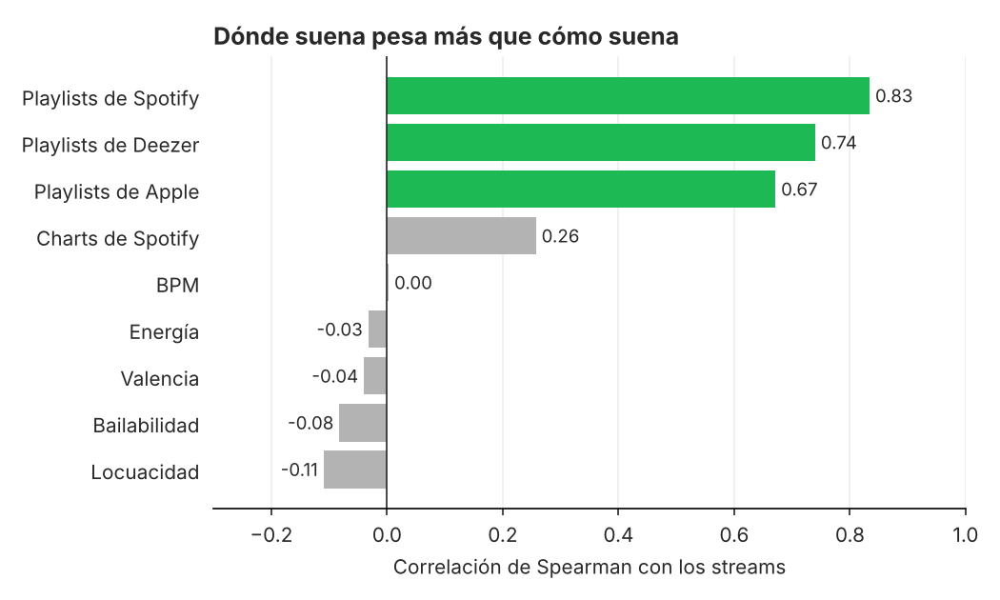
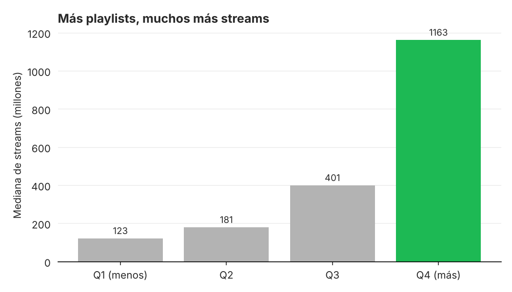
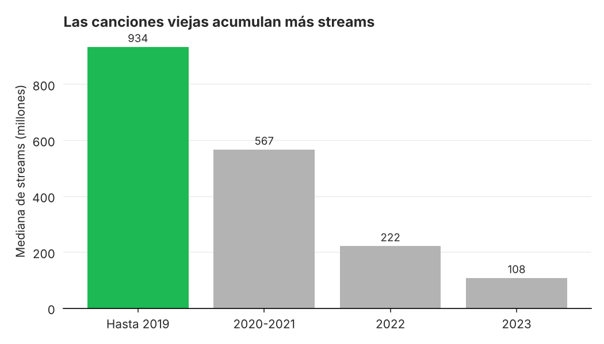
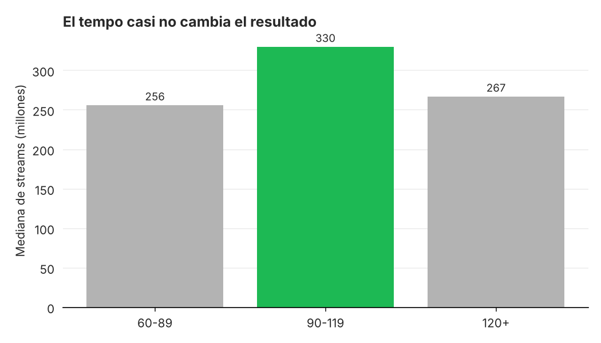

# ¿Qué hace exitosa una canción en Spotify? (2023)

[](https://github.com/scheffan/spotify-2023-looker/actions/workflows/tests.yml)


Análisis de las 948 canciones más escuchadas de Spotify en 2023: qué tienen en común los hits y qué no importa tanto como parece. Los datos se limpian con Python, las métricas salen de consultas SQL y el resultado se presenta en un dashboard interactivo de Looker Studio.

**Ver el dashboard:** https://lookerstudio.google.com/reporting/93c4c2a4-873d-45c7-98cc-6f7fc109100a

## Hallazgos

| | |
| --- | --- |
| **948** canciones · **644** artistas | **488 mil millones** de streams en total |
| El **10 %** más escuchado se lleva el **36,8 %** de los streams | Mediana: **289 millones** de streams por canción |

**1. Dónde suena pesa más que cómo suena.** La cantidad de playlists de Spotify en las que aparece una canción tiene una correlación de 0,83 con sus streams. Las características del audio (bailabilidad, energía, valencia, BPM) no pasan de 0,11 en valor absoluto.



**2. Más playlists, muchos más streams.** Las canciones del cuartil con más playlists tienen una mediana de 1.163 millones de streams, 9,5 veces más que las del cuartil con menos (123 millones). Ojo: es una asociación, no prueba causa. Un tema que ya es hit también entra en más playlists.



**3. El tiempo juega a favor.** Las canciones lanzadas hasta 2019 tienen una mediana de 934 millones de streams, contra 108 millones de las de 2023. El dataset mide streams acumulados, así que comparar canciones de distintos años sin tener esto en cuenta lleva a conclusiones equivocadas.



**4. El tempo casi no cambia el resultado.** El rango de 120+ BPM suma más streams en total (249 mil millones) solo porque tiene más canciones (513 de 948). Por canción, el rango de 90 a 119 BPM tiene la mediana más alta (330 millones contra 267 millones de 120+), y es también el más bailable (70,6 % promedio).



## Cómo está armado

```
data/raw/            CSV exportado de la fuente del dashboard (952 filas)
src/limpieza.py      limpieza -> data/processed/spotify_2023_limpio.csv (948 filas)
sql/consultas.sql    una consulta por KPI o gráfico del dashboard (DuckDB)
src/analisis.py      corre las consultas y genera los gráficos de docs/img/
tests/               tests de la limpieza y de las consultas (pytest)
```

**Limpieza:**

- La fecha de lanzamiento tenía el día y el mes invertidos cuando el día era 12 o menos. Se arma de nuevo a partir del año, el mes y el día.
- Había 4 canciones repetidas con distinta cantidad de streams. Se queda la fila con más streams.
- `charts_shazam` y `playlists_deezer` venían como texto con separador de miles ("1,021") y se pasan a número.
- Se agregan los campos que usa el dashboard: rango de BPM, nivel de valencia y bailabilidad, época de lanzamiento y cuartil de playlists.

Cada número de este README sale de `python src/analisis.py`, y el workflow de GitHub Actions lo vuelve a correr en cada push junto con los tests.

## Correrlo

```bash
pip install -r requirements.txt
python src/limpieza.py
python src/analisis.py
pytest -q
```

## Datos

Dataset público de Kaggle [Most Streamed Spotify Songs 2023](https://www.kaggle.com/datasets/nelgiriyewithana/top-spotify-songs-2023), con columnas renombradas al español. Los streams son acumulados hasta 2023, no solo de ese año.

## Licencia

MIT
